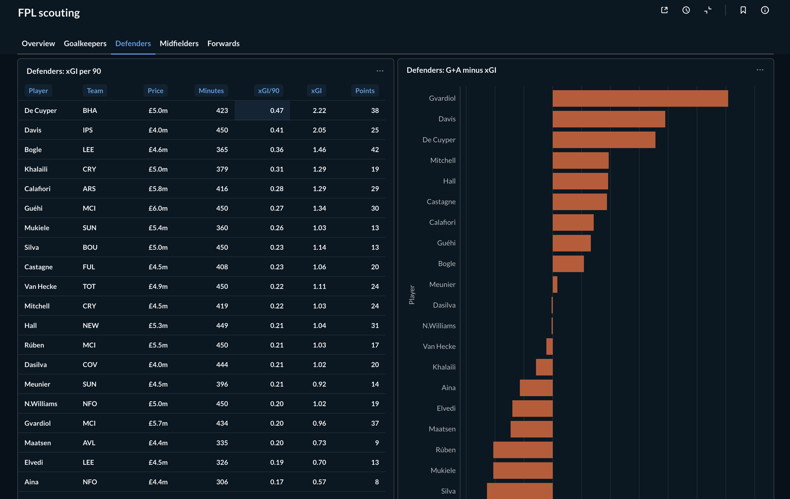
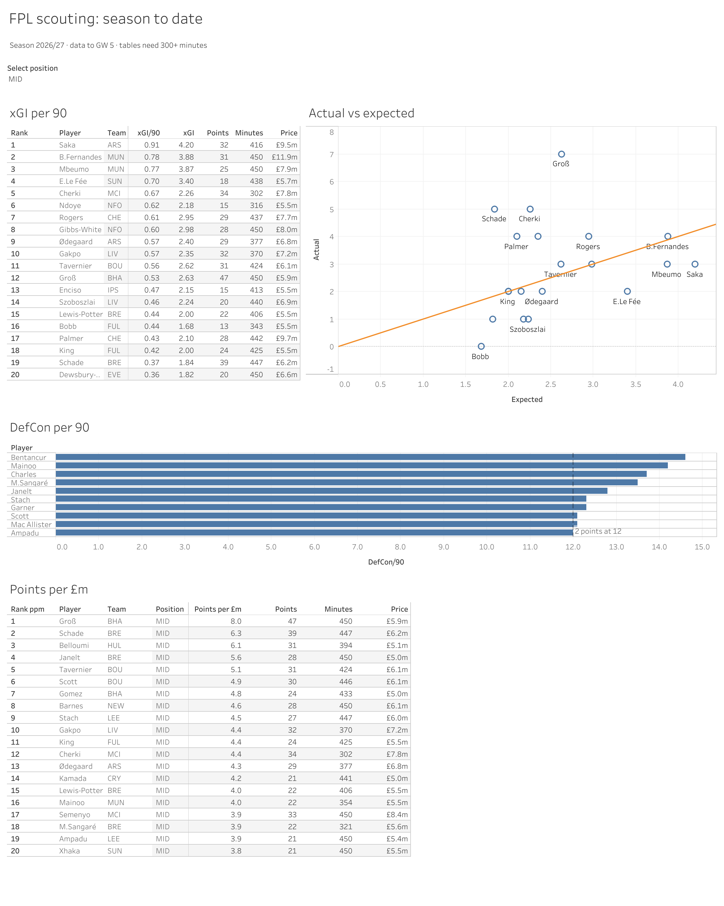
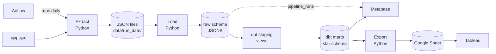
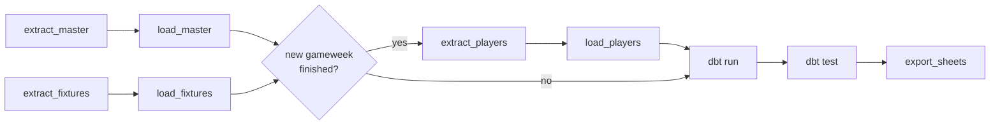
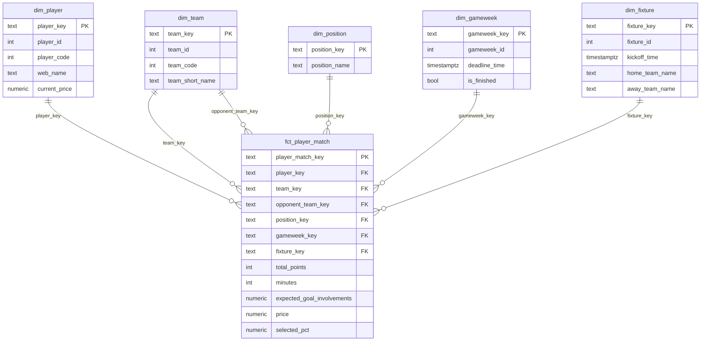
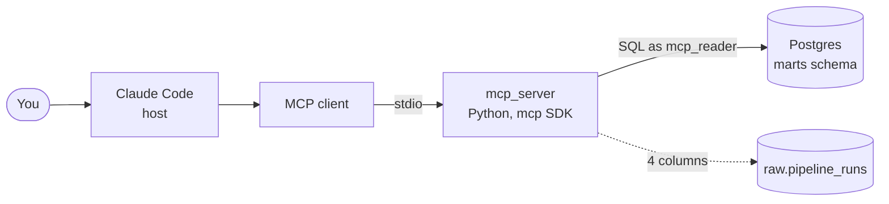

# FPL Data Pipeline
A daily ELT pipeline for Fantasy Premier League (FPL) data. Python extracts the FPL API, PostgreSQL stores the raw JSON, dbt builds a tested star schema, Airflow runs it every day, and Metabase and Tableau show the results.
A read-only MCP server lets an AI agent such as Claude Code answer FPL questions with the warehouse's numbers, through 4 fixed tools and a database role that can't write.

**Stack:** Python, PostgreSQL, dbt Core, Apache Airflow, Metabase, Tableau, Google Sheets API, Docker. 



**Live dashboard:** [FPL scouting on Tableau](https://public.tableau.com/app/profile/tsz.hin.mervin.yu/viz/FPLScouting/Season), updated daily.

## What it does

- Every day at 08:00 HKT, it saves the FPL master file (players, teams, gameweeks) and the fixtures as JSON, and loads them into Postgres as JSONB.
- After each gameweek, it also saves every player's match history.
- Every day, dbt rebuilds the models from the latest files and runs the tests, so prices and player status are never more than a day old.
- dbt builds 5 dimensions and 1 fact table (one row per player per fixture), plus 4 analysis tables.
- A script builds two Metabase dashboards: **FPL scouting** (season to date) and **FPL form** (each player's last N games, default 5).
- After the tests pass, it writes the current season's scouting tables to a Google Sheet. Tableau re-reads the sheet every day for two public dashboards: **Season** and **Form**.
- A read-only MCP server lets Claude Code answer FPL questions from the warehouse. See [Ask the warehouse (MCP)](#ask-the-warehouse-mcp).

## Pipeline



The Airflow DAG `fpl_daily`:



- Master and fixtures load every day, so the warehouse keeps a daily snapshot of prices and player status.
- The gate compares the newest finished gameweek in today's master file with the one at the last player load. Player histories only change after a gameweek, so on other days the player calls are skipped.
- dbt runs every day either way (trigger rule `none_failed`), so current prices and player status come from today's master file.
- `export_sheets` exits with code 99 when `GOOGLE_SHEET_ID` is empty, and Airflow marks it skipped. The pipeline works without a Google account.

## Data model



- The fact table has one row per player per fixture, with every match stat, the price and the ownership percent. Every key is made from the season and the FPL id, because FPL reuses ids each season.
- The foreign keys live on the fact table (for example, the player's team at match time), so the dimensions never point at each other. This keeps a star schema.
- Analysis tables built from the fact table:

| Table | One row per | Used for |
| --- | --- | --- |
| `player_season_stats` | player and season | totals, per-90 rates, points per £m |
| `player_form` | player and match | rolling 5-match form |
| `player_scouting` | player and season | the season stats with name, team and position (dashboard FPL scouting) |
| `player_scouting_last_n` | player and window of last N games | the same stats over each player's last N games (dashboard FPL form) |

## Setup
This project requires Docker, [uv](https://docs.astral.sh/uv/) and git.
1. Clone the repo and create `.env` with random secrets:

   ```bash
   git clone https://github.com/yutsz1203/fpl-data-pipeline.git
   cd fpl-data-pipeline
   cp .env.example .env
   uv run python -c "import pathlib, re, secrets; p = pathlib.Path('.env'); p.write_text(re.sub('=change-me$', lambda m: '=' + secrets.token_hex(16), p.read_text(), flags=re.M))"
   ```

2. Build the Airflow image, then start the stack:

   ```bash
   mkdir -p airflow/logs data secrets
   docker compose build airflow-init
   docker compose up -d --wait
   ```

3. Run the pipeline once:

   ```bash
   docker compose exec airflow-scheduler airflow dags unpause fpl_daily
   ```
    Follow it in the Airflow UI at http://localhost:8080 (user `admin`, password `AIRFLOW_ADMIN_PASSWORD` from `.env`), or wait until this shows `success`:

   ```bash
   docker compose exec airflow-scheduler airflow dags list-runs fpl_daily
   ```

4. Build the dashboards:

   ```bash
   uv run python metabase/provision.py
   ```

   Open http://localhost:3000 and log in with `METABASE_ADMIN_EMAIL` and `METABASE_ADMIN_PASSWORD` from `.env`.

5. Optional: the Google Sheet for Tableau.
   1. In Google Cloud, create a project, enable the Google Sheets API, and create a service account with no roles. Create a JSON key and save it as `secrets/google-service-account.json`.
   2. Create a Google Sheet with two tabs, `season` and `last_n`, and share it with the service account's email as Editor.
   3. Set `GOOGLE_SHEET_ID` in `.env` to the part of the sheet's URL between `/d/` and `/edit`, then run `docker compose up -d`.
   4. In Tableau Public, connect to the sheet through Google Drive. Add your Google account under saved credentials in your Tableau Public settings, then publish with "Keep my data in sync".
   
## Day to day

- `docker compose stop` and `docker compose up -d` keep all data. Do not run `docker compose down -v`: it deletes the warehouse and the Metabase database.
- Never change `METABASE_ENCRYPTION_KEY` after the first start. Metabase can't read its own database without it.
- The Airflow image contains copies of `dbt/` and `scripts/`. After you change them, run `docker compose up -d --build`.
- You can rerun `metabase/provision.py` at any time. It updates the cards and dashboards in place and overwrites changes made in the Metabase UI.
- To run dbt from your machine: `cd dbt`, then `uv run dbt deps` once, then `uv run dbt build`. The warehouse is on `localhost:5433`.
- Notebooks: `uv run jupyter lab notebooks/`.
- The export overwrites both tabs of the Google Sheet every day, so don't edit the sheet by hand. For a refresh sooner than Tableau Public's daily one, click **Request Update** on the viz page.

## Ask the warehouse (MCP)

`mcp_server/` is a small read-only [MCP](https://modelcontextprotocol.io) server over the `marts` schema. Connect it to any ai agents (e.g. Claude Code) and ask FPL questions in plain English, for example "best midfielders under £7m over the last 5 games". The model answers with the warehouse's numbers, not with what it remembers.



Claude Code starts the server as a child process and talks to it over stdin and stdout. Nothing listens on a port.

| Kind | Name | What it does |
| --- | --- | --- |
| Tool | `search_players` | Finds players by part of their name, ignoring case and accents, and returns their `player_key` |
| Tool | `top_players` | Ranks one position by one stat, with an optional price limit, for the season or the last N games |
| Tool | `player_form` | One player's last N games, game by game, plus totals |
| Tool | `player_season` | One player's season totals and per-90 rates |
| Resource | `fpl://schema` | The tables behind the tools, their columns, and a glossary of the stats |
| Resource | `fpl://freshness` | The latest finished gameweek and the last successful run of each pipeline step |
| Prompt | `scout_position` | Finds the best players in a position under a budget, by season and last 5 games |
| Prompt | `transfer_check` | Compares the player you want to sell with the player you want to buy |

Every tool result says which gameweek the data runs to (`data_to_gameweek`).

### Setup

1. The role `mcp_reader` is created by `sql/init/04_create_mcp_reader.sql` when the warehouse starts on an empty volume. Its password is `MCP_READER_PASSWORD` in `.env`. If your warehouse already existed before this file was added, run it once:

   ```bash
   docker compose up -d warehouse
   docker compose exec -T warehouse sh -c 'psql -U "$POSTGRES_USER" -d "$POSTGRES_DB" -v ON_ERROR_STOP=1' < sql/init/04_create_mcp_reader.sql
   ```

2. Register the server with Claude Code. Use the absolute path to your clone:

   ```bash
   claude mcp add fpl -- uv run --directory /absolute/path/to/fpl-data-pipeline python -m mcp_server.server
   ```

3. Start Claude Code and run `/mcp`. `fpl` must show as connected, with 4 tools.

To look at the raw requests and results without a model, use the MCP Inspector: `npx @modelcontextprotocol/inspector uv run python -m mcp_server.server`.


### Tests

```bash
uv run pytest
```

- `tests/test_validation.py` needs no database. It checks that each bad argument is rejected with a readable reason before any query runs, and that the server lists exactly 4 read-only tools.
- `tests/test_integration.py` needs the running warehouse and is skipped if it can't connect. It calls each tool, checks the row caps, and checks that `mcp_reader` can't insert and that a 5-second query is cancelled.

## Project layout
```
fpl-data-pipeline/
├── airflow/                  # Dockerfile and the DAG (dags/fpl_daily.py)
├── dbt/                      # dbt project with its own uv environment: staging, marts, tests
├── images/                   # README screenshots
├── mcp_server/               # read-only MCP server: tools, resources, prompts
├── metabase/                 # provision.py: the dashboards as code
├── notebooks/                # API exploration and the top-players analysis
├── scripts/                  # extract, load and Google Sheets export scripts, run log
├── secrets/                  # Google service account key (git-ignored, optional)
├── sql/                      # schemas, raw tables and the read-only Metabase and MCP roles
└── tests/                    # pytest tests for the MCP server
```

