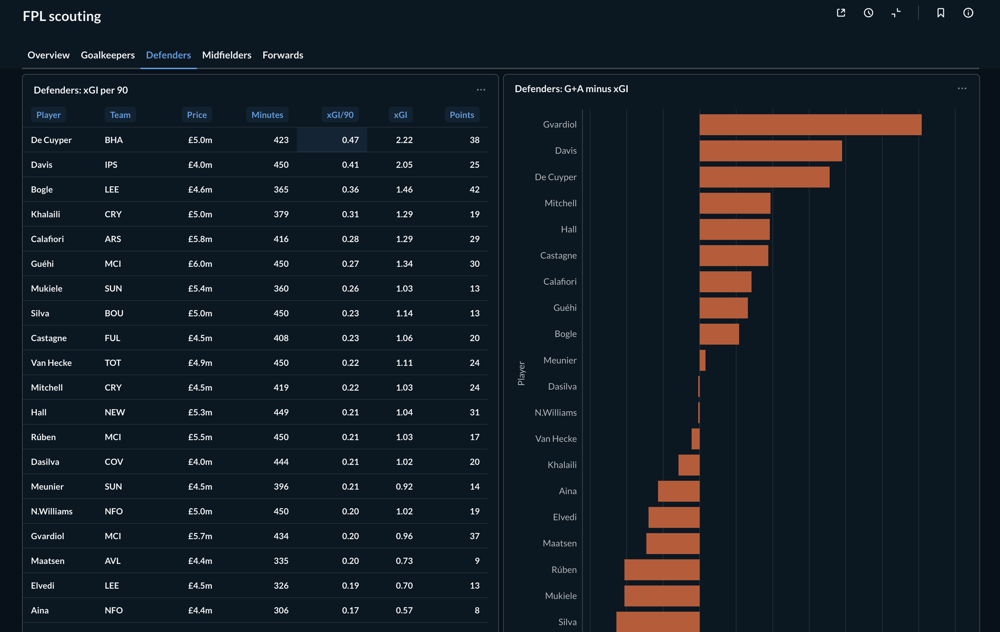
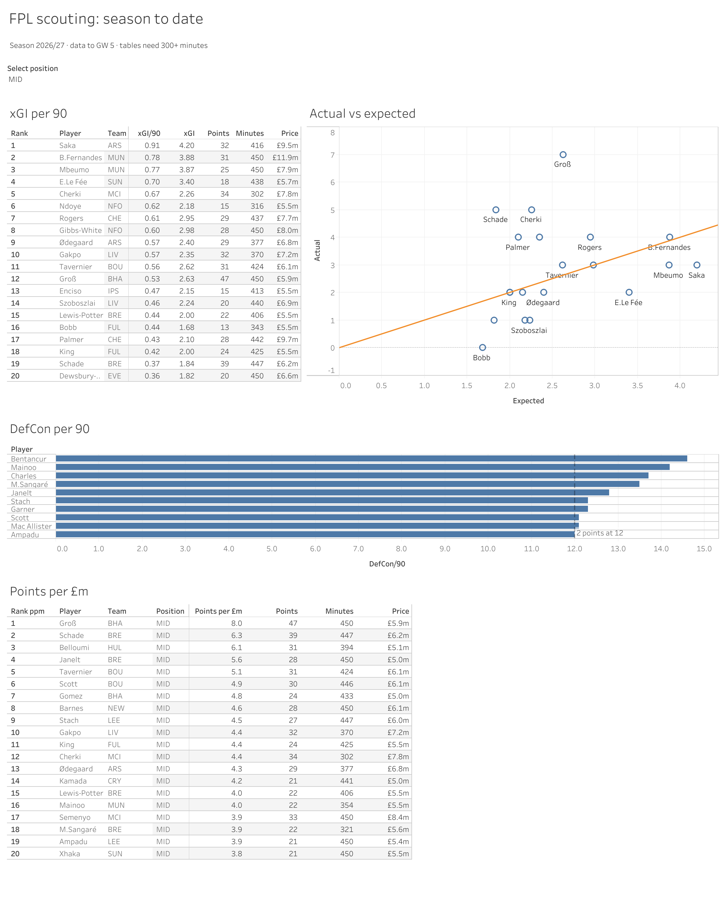
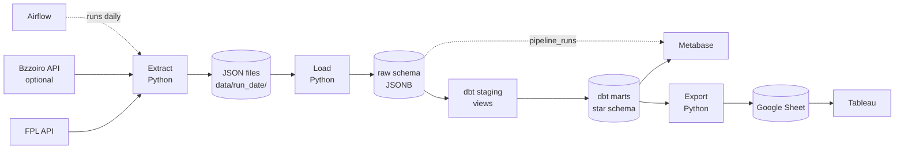
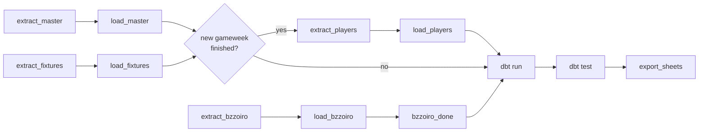
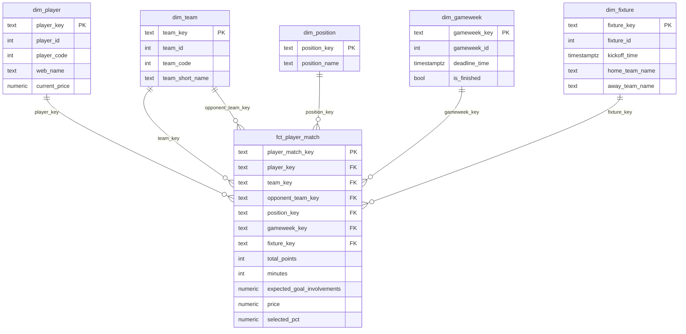
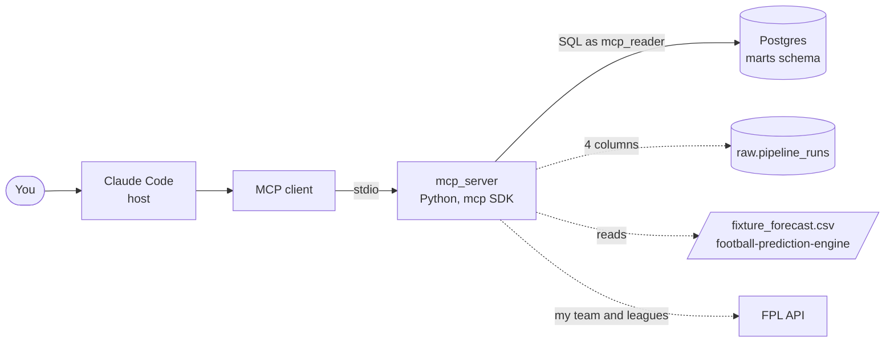

# FPL Data Pipeline
A daily ELT pipeline for Fantasy Premier League (FPL) data. Python extracts the FPL API, PostgreSQL stores the raw JSON, dbt builds a tested star schema, Airflow runs it every day, and Metabase and Tableau show the results.
A read-only MCP server lets an AI agent such as Claude Code answer FPL questions with the warehouse's numbers, through 14 fixed tools and a database role that can't write.

**Stack:** Python, PostgreSQL, dbt Core, Apache Airflow, Metabase, Tableau, Google Sheets API, Docker. 



**Live dashboard:** [FPL scouting on Tableau](https://public.tableau.com/app/profile/tsz.hin.mervin.yu/viz/FPLScouting/Season), updated daily.

## What it does

- Every day at 08:00 HKT, it saves the FPL master file (players, teams, gameweeks) and the fixtures as JSON, and loads them into Postgres as JSONB.
- After each gameweek, it also saves every player's match history.
- Optional: every day, it saves Premier League lineups (confirmed and predicted) and injury lists from the [Bzzoiro API](https://sports.bzzoiro.com).
- Every day, dbt rebuilds the models from the latest files and runs the tests, so prices and player status are never more than a day old.
- dbt builds 5 dimensions and 3 fact tables (player per fixture, player per day, player per lineup), plus 9 analysis tables.
- A script builds two Metabase dashboards: **FPL scouting** (season to date) and **FPL form** (each player's last N games, default 5).
- After the tests pass, it writes the current season's scouting tables to a Google Sheet. Tableau re-reads the sheet every day for two public dashboards: **Season** and **Form**.
- A read-only MCP server lets Claude Code answer FPL questions from the warehouse. See [Ask the warehouse (MCP)](#ask-the-warehouse-mcp).

## Pipeline



The Airflow DAG `fpl_daily`:



- Master and fixtures load every day, so the warehouse keeps a daily snapshot of prices and player status.
- The gate compares the newest finished gameweek in today's master file with the one at the last player load. Player histories only change after a gameweek, so on other days the player calls are skipped.
- dbt runs every day either way (trigger rule `none_failed`), so current prices and player status come from today's master file.
- `export_sheets` exits with code 99 when `GOOGLE_SHEET_ID` is empty, and Airflow marks it skipped. The pipeline works without a Google account.
- `extract_bzzoiro` exits with code 99 when `BZZOIRO_TOKEN` is empty or the API fails, and Airflow marks it and `load_bzzoiro` skipped. If either task fails for another reason (for example, Airflow kills it), `bzzoiro_done` (trigger rule `all_done`) still lets dbt run. In both cases dbt builds the lineup tables from the last good load, so a problem at Bzzoiro never stops the FPL run. A failed Bzzoiro task is still written to `airflow/logs/failures.log`, but the DAG run shows `success`.
- Airflow runs on a laptop that sleeps. While the Mac sleeps, the containers stop but the clock goes on. The Execution API token of a running task is valid for 24 hours (`AIRFLOW__EXECUTION_API__JWT_EXPIRATION_TIME`, default 10 minutes), so the task continues after the Mac wakes. With the default, every task that was running during a sleep longer than 10 minutes failed with `Invalid auth token`.

## Data model



- The fact table has one row per player per fixture, with every match stat, the price and the ownership percent. Every key is made from the season and the FPL id, because FPL reuses ids each season.
- The foreign keys live on the fact table (for example, the player's team at match time), so the dimensions never point at each other. This keeps a star schema.
- Analysis tables built from the fact table:

| Table | One row per | Used for |
| --- | --- | --- |
| `player_season_stats` | player and season | totals, per-90 rates, points per £m |
| `player_form` | player and match | rolling 5-match form |
| `player_scouting` | player and season | the season stats with name, team and position (dashboard FPL scouting) |
| `player_scouting_last_n` | player and window of last N games | the same stats over each player's last N games (dashboard FPL form) |
| `player_projection` | player | recent minutes and per-90 rates, the inputs of the MCP server's points projection |
| `game_rules` | season | the scoring, squad and chip rules that FPL publishes in the master file |
| `bzzoiro_player_map` | FPL player | the matching Bzzoiro player, found by club, birth date and name |
| `player_injury` | injured or suspended player | Bzzoiro's injury list with FPL player keys |
| `next_predicted_lineup` | team and player | each team's predicted lineup for its next match |

- Two more fact tables sit beside `fct_player_match`:
  - `fct_player_daily` has one row per player per daily master file: price, status, news, ownership and transfers. It shows price changes and how long a player was flagged.
  - `fct_lineup` has one row per player per lineup, confirmed or predicted, with the formation and who started.

## Setup
This project requires Docker, [uv](https://docs.astral.sh/uv/) and git.
1. Clone the repo and create `.env` with random secrets:

   ```bash
   git clone https://github.com/yutsz1203/fpl-data-pipeline.git
   cd fpl-data-pipeline
   cp .env.example .env
   uv run python -c "import pathlib, re, secrets; p = pathlib.Path('.env'); p.write_text(re.sub('=change-me$', lambda m: '=' + secrets.token_hex(16), p.read_text(), flags=re.M))"
   ```

2. Build the Airflow image, then start the stack:

   ```bash
   mkdir -p airflow/logs data secrets
   docker compose build airflow-init
   docker compose up -d --wait
   ```

3. Run the pipeline once:

   ```bash
   docker compose exec airflow-scheduler airflow dags unpause fpl_daily
   ```
    Follow it in the Airflow UI at http://localhost:8080 (user `admin`, password `AIRFLOW_ADMIN_PASSWORD` from `.env`), or wait until this shows `success`:

   ```bash
   docker compose exec airflow-scheduler airflow dags list-runs fpl_daily
   ```

4. Build the dashboards:

   ```bash
   uv run python metabase/provision.py
   ```

   Open http://localhost:3000 and log in with `METABASE_ADMIN_EMAIL` and `METABASE_ADMIN_PASSWORD` from `.env`.

5. Optional: the Google Sheet for Tableau.
   1. In Google Cloud, create a project, enable the Google Sheets API, and create a service account with no roles. Create a JSON key and save it as `secrets/google-service-account.json`.
   2. Create a Google Sheet with two tabs, `season` and `last_n`, and share it with the service account's email as Editor.
   3. Set `GOOGLE_SHEET_ID` in `.env` to the part of the sheet's URL between `/d/` and `/edit`, then run `docker compose up -d`.
   4. In Tableau Public, connect to the sheet through Google Drive. Add your Google account under saved credentials in your Tableau Public settings, then publish with "Keep my data in sync".

6. Optional: lineups and injuries. Get a token at [sports.bzzoiro.com](https://sports.bzzoiro.com), set `BZZOIRO_TOKEN` in `.env`, then run `docker compose up -d`. If your warehouse already existed before the Bzzoiro tables were added, create them once:

   ```bash
   docker compose exec -T warehouse sh -c 'psql -U "$POSTGRES_USER" -d "$POSTGRES_DB" -v ON_ERROR_STOP=1' < sql/init/05_create_bzzoiro_tables.sql
   ```
   
## Day to day

- `docker compose stop` and `docker compose up -d` keep all data. Do not run `docker compose down -v`: it deletes the warehouse and the Metabase database.
- Never change `METABASE_ENCRYPTION_KEY` after the first start. Metabase can't read its own database without it.
- The Airflow image contains copies of `dbt/` and `scripts/`. After you change them, run `docker compose up -d --build`.
- You can rerun `metabase/provision.py` at any time. It updates the cards and dashboards in place and overwrites changes made in the Metabase UI.
- To run dbt from your machine: `cd dbt`, then `uv run dbt deps` once, then `uv run dbt build`. The warehouse is on `localhost:5433`.
- Notebooks: `uv run jupyter lab notebooks/`.
- The export overwrites both tabs of the Google Sheet every day, so don't edit the sheet by hand. For a refresh sooner than Tableau Public's daily one, click **Request Update** on the viz page.

## Ask the warehouse (MCP)

`mcp_server/` is a small read-only [MCP](https://modelcontextprotocol.io) server over the `marts` schema. Connect it to any ai agents (e.g. Claude Code) and ask FPL questions in plain English, for example "best midfielders under £7m over the last 5 games". The model answers with the warehouse's numbers, not with what it remembers.



Claude Code starts the server as a child process and talks to it over stdin and stdout. Nothing listens on a port.

| Kind | Name | What it does |
| --- | --- | --- |
| Tool | `search_players` | Finds players by part of their name, team, position or price limit, and returns their `player_key`, status and ownership |
| Tool | `top_players` | Ranks one position by one stat, with optional price, team and minutes limits, for the season or the last N games |
| Tool | `player_form` | One player's last N games, game by game, plus totals |
| Tool | `player_season` | One player's season totals, per-90 rates, set-piece duties, and home/away and difficulty splits |
| Tool | `player_status` | One player's availability, news, price changes and injury details |
| Tool | `availability` | Every flagged player (injured, doubtful, suspended), for the league or one team |
| Tool | `market_watch` | Players ranked by transfers in or out, ownership or price change |
| Tool | `fixture_outlook` | Each team's next N gameweeks: opponents, FPL difficulty, blank and double gameweeks, and forecast goals for and against and clean sheet chances |
| Tool | `projected_points` | A rough points projection per player for the next N gameweeks, from expected minutes, per-90 rates and the fixture forecast |
| Tool | `team_lineups` | One team's recent confirmed lineups and its predicted lineup for the next match |
| Tool | `my_team` | Your own FPL squad from the live FPL API: players, bank, selling prices, free transfers, chips and your leagues |
| Tool | `league_standings` | One classic league's table from the live FPL API, 50 teams a page |
| Tool | `rival_compare` | Your squad against up to 10 rivals in a league: their captains and chips, the players they own that you don't (threats), and how many of them own each of your players (differentials) |
| Tool | `fpl_rules` | This season's FPL rules as text. The same content as `fpl://rules` |
| Resource | `fpl://schema` | The tables behind the tools, their columns, and a glossary of the stats |
| Resource | `fpl://freshness` | The latest finished gameweek and the last successful run of each pipeline step |
| Resource | `fpl://rules` | This season's FPL rules: scoring, squad limits and chips from the warehouse, plus notes on transfers and prices |
| Prompt | `scout_position` | Finds the best players in a position under a budget, by season, last 5 games and next 5 fixtures |
| Prompt | `transfer_check` | Compares the player you want to sell with the player you want to buy, including their next 5 fixtures |
| Prompt | `plan_gameweek` | Plans your next gameweek for the most points: transfers or a roll, chips, captain and bench. Compares each player it suggests buying with the one it suggests selling. With a league name, it also finds the threats and differentials against your rivals there |

Every tool result says which gameweek the data runs to (`data_to_gameweek`).

- `my_team`, `league_standings` and `rival_compare` call the public FPL API, with no login. All other tools read `marts` only.
- `rival_compare` shows every squad as it was at the last deadline. FPL does not publish a rival's transfers for the next gameweek in their team sheet until the deadline passes.
- The rules are both a resource and a tool. Claude Code lists tools at the start of every session but does not read resources on its own, so `fpl_rules` and the server's instructions make sure rule questions are answered from this season's rules and not from the model's memory.
- `projected_points` is a simple model and is not backtested. Use it to compare players, not as a points forecast.
- The numbers in `fpl://rules` come from `marts.game_rules`, so they follow the season automatically. The rules that FPL only publishes as text (transfers, selling prices, chip details) are in `mcp_server/rules/<season>.md`. Write a new file each season: until you do, the resource shows last season's notes with a warning.
- `team_lineups`, the injury details in `player_status` and the predicted lineups need the Bzzoiro load (Setup step 6). Without it, `team_lineups` has nothing to show and `player_status` gives FPL's own status and news only.

### Setup

1. The role `mcp_reader` is created by `sql/init/04_create_mcp_reader.sql` when the warehouse starts on an empty volume. Its password is `MCP_READER_PASSWORD` in `.env`. If your warehouse already existed before this file was added, run it once:

   ```bash
   docker compose up -d warehouse
   docker compose exec -T warehouse sh -c 'psql -U "$POSTGRES_USER" -d "$POSTGRES_DB" -v ON_ERROR_STOP=1' < sql/init/04_create_mcp_reader.sql
   ```

2. Register the server with Claude Code. Use the absolute path to your clone:

   ```bash
   claude mcp add fpl -- uv run --directory /absolute/path/to/fpl-data-pipeline python -m mcp_server.server
   ```

3. Optional: the forecast. `fixture_outlook` always shows fixtures and FPL difficulty. For forecast goals, set `FORECAST_CSV` in `.env` to the `teams/projection/fixture_forecast.csv` file that [football-prediction-engine](https://github.com/yutsz1203/football-prediction-engine) writes each week. For gameweeks that the file doesn't cover, or without the file, the server makes its own simpler forecast from this season's results and marks it `fallback`.

4. Optional: your own team. Set `FPL_ENTRY_ID` in `.env` to the number in your FPL "Points" page URL (`/entry/<id>/event/...`), and `FPL_ENTRY_SEASON` to the season it belongs to, for example `2026/27`. FPL issues new ids every season, so `my_team` refuses an id from another season and asks for a new one.

5. Start Claude Code and run `/mcp`. `fpl` must show as connected, with 14 tools.

The code is split by job: `server.py` only starts the server, `app.py` holds the server object, `db.py` the connection and shared lookups, `tools/` one module per group of tools (`players`, `market`, `fixtures`, `entry`, `leagues`, `rules`), and `resources.py`, `prompts.py`, `queries.py`, `classes.py` and `constants.py` the rest.

To look at the raw requests and results without a model, use the MCP Inspector: `npx @modelcontextprotocol/inspector uv run python -m mcp_server.server`.


### Tests

```bash
uv run pytest
```

- `tests/test_validation.py` needs no database. It checks that each bad argument is rejected with a readable reason before any query runs, that the server lists exactly 14 read-only tools, of which only the three FPL API tools call outside the warehouse, and that the instructions and the `plan_gameweek` prompt point to `fpl_rules`.
- `tests/test_squad.py` and `tests/test_projection.py` need no database. They check the selling price, free transfer and chip rules, and the projection maths.
- `tests/test_integration.py` needs the running warehouse and is skipped if it can't connect. It calls each tool (the three FPL API tools with a mocked API), checks the row caps and the forecast join, and checks that `mcp_reader` can't insert and that a 5-second query is cancelled.

## Project layout
```
fpl-data-pipeline/
├── airflow/                  # Dockerfile and the DAG (dags/fpl_daily.py)
├── dbt/                      # dbt project with its own uv environment: staging, marts, tests
├── images/                   # README screenshots
├── mcp_server/               # read-only MCP server: tools, resources, prompts
├── metabase/                 # provision.py: the dashboards as code
├── notebooks/                # API exploration and the top-players analysis
├── scripts/                  # extract, load and Google Sheets export scripts, run log
├── secrets/                  # Google service account key (git-ignored, optional)
├── sql/                      # schemas, raw tables and the read-only Metabase and MCP roles
└── tests/                    # pytest tests for the MCP server
```

